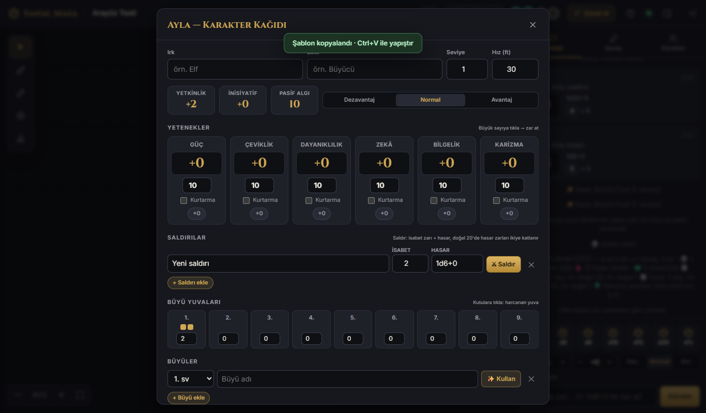
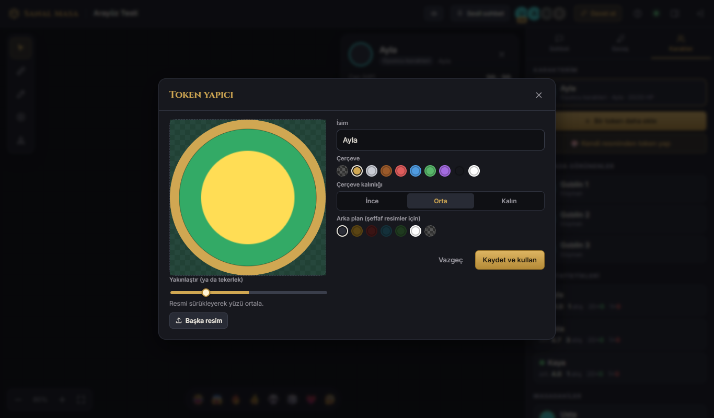
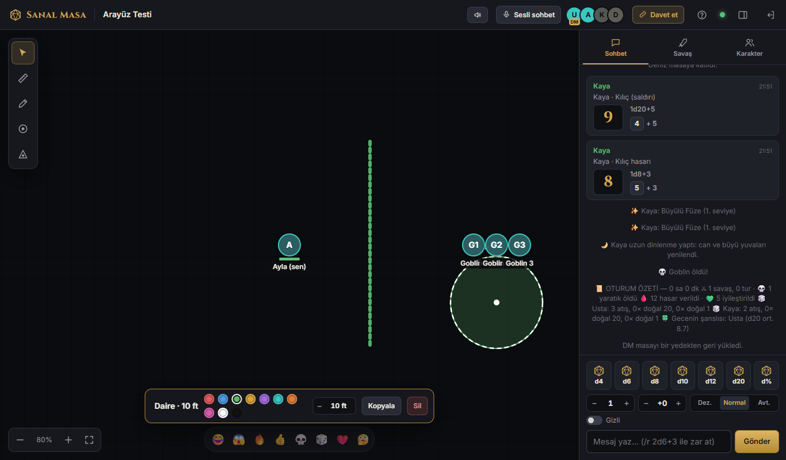

# 🎲 Sanal Masa

**Tarayıcıdan oynanan, kurulumu 2 dakika süren çevrimiçi Dungeons & Dragons masası.**
DM kendi bilgisayarında çalıştırır, oyuncular gelen linke tıklar. Hesap, abonelik, port açma yok.



## Neler var?

| | |
|---|---|
| 🗺️ **Harita** | Sürükle, yakınlaştır, ızgara ayarı, telefonda iki parmakla kullanım |
| 👁️ **Dinamik görüş** | Duvarlar ve kapılar görüşü keser, karanlıkta sadece ışık ve karanlık görüş işe yarar |
| 🌫️ **Savaş sisi** | DM alan alan açar. Görünmeyen düşmanlar oyuncunun tarayıcısına hiç gönderilmez |
| 🔥 **Alan şablonları** | Fireball dairesi, koni, çizgi, kare; içindeki hedefleri sayar. Taşı, rengini değiştir, Ctrl+C / Ctrl+V |
| 🎨 **Token yapıcı** | Herhangi bir resimden yuvarlak, çerçeveli token: yükle, sürükle-bırak ya da yapıştır |
| 📜 **Karakter kağıdı** | Yetenekler, beceriler, saldırılar, büyüler, büyü yuvaları. Tıkla, zar atılsın |
| ⚔️ **Savaş** | İnisiyatif, tur takibi, "Sıra sende!" bildirimi, ölen yaratık duyurusu |
| 🎲 **Zarlar** | Tek tık, avantaj/dezavantaj, `/r 2d6+3`, doğal 20 ve 1 animasyonları |
| 🎙️ **Sesli sohbet** | Discord gerekmez; tarayıcıdan tarayıcıya, kişi başı ses ayarı |
| 🌧️ **Ortam sesi** | Yağmur, fırtına, taverna, mağara… ya da kendi müziğin. Herkes kendi ses düzeyini ayarlar |
| 🐉 **Hazır yaratıklar** | Goblin'den Kırmızı Ejderha'ya, HP ve AC otomatik |
| 🖼️ **Görsel göster** | DM bir mektubu ya da NPC portresini herkesin ekranında açar |
| ↩️ **Geri al** | Ctrl+Z: taşıma, silme, çizim, hasar… |
| 💾 **Otomatik yedek** | 10 dakikada bir; tek tıkla geri yükleme, masayı dosya olarak taşıma |
| 📊 **Oturum özeti** | Gecenin sonunda kim kaç kritik attı, kaç yaratık öldü |

<p>
  
  
</p>

## Kurulum (sadece DM) — indir, çift tıkla

### ⬇️ [En son sürümü indir](https://github.com/vxlhr/sanal-masa/releases/latest)

| Sistem | Dosya | Nasıl açılır |
|---|---|---|
| **Windows** | `SanalMasa-Windows.exe` | Bir klasöre koy, çift tıkla |
| **Mac** (M1–M4) | `SanalMasa-Mac-arm64.tar.gz` | Çift tıkla (açılır), çıkan `SanalMasa`'ya çift tıkla |
| **Linux** | `SanalMasa-Linux-x64.tar.gz` | Çıkar, `./SanalMasa` |

Hepsi bu kadar. **Node.js, hesap ya da port açma gerekmez.** Program açılınca:

1. Tarayıcında masa açılır.
2. Masa kendiliğinden internete bağlanır. Pencerede ve masadaki **Davet et** düğmesinde
   `https://kelime-kelime-kelime.trycloudflare.com` gibi bir adres çıkar.
3. Bu adresi arkadaşlarına gönder. Hangi şehirde, hangi ağda olurlarsa olsunlar bağlanırlar.

**DM şifresi** pencerede yazar (ilk açılışta rastgele üretilir). Kayıtların, yedeklerin ve şifre ayarın
programın yanındaki `SanalMasa-Veri` klasöründe durur; programı her zaman aynı klasörden aç.

> **Windows "bilgisayarınızı korudu" derse:** "Ek bilgi" → "Yine de çalıştır". (Program imzalı değil;
> imza için yıllık ücretli sertifika gerekiyor.)
> **Mac "doğrulanamadı" derse:** Sistem Ayarları → Gizlilik ve Güvenlik → "Yine de aç".

> İnternete açma işi Cloudflare'in **ücretsiz ve hesapsız** hızlı tüneliyle yapılır. Gereken program
> (`cloudflared`) ilk açılışta kendiliğinden indirilir. Adres her açılışta değişir, her oyun gecesi yenisini gönder.
> Herkes aynı evdeyse ve internete açmak istemiyorsan programı `--yerel` ile başlatabilirsin.

<details>
<summary>Kaynak koddan çalıştırmak (Node.js ile)</summary>

1. [Node.js](https://nodejs.org) (LTS) kur.
2. **Code → Download ZIP** ile indir ve bir klasöre çıkar.
3. Windows: `INTERNETE-AC.bat` (ya da aynı ev için `BASLAT.bat`).
   Mac / Linux: `bash internete-ac.sh` (ya da `bash baslat.sh`).

Bu şekilde kayıtlar proje içindeki `data/` klasöründe durur.
</details>

## Haritalar ve görseller

Programla birlikte hazır harita ya da token resmi gelmez. Kendi haritalarını **Haritalar → Yeni sahne → Bilgisayardan yükle**
ile eklersin; tokenları **Token yapıcı** ile istediğin resimden yaparsın. Telifli görselleri yalnızca kendi masanda,
hak sahibinin izin verdiği ölçüde kullan.

## Oyuncular için

Gelen linke tıkla, adını yaz, **Masaya otur**. Bir şey kurman gerekmez; telefonda da çalışır.
Sayfa yenilense ya da internet kopsa kendiliğinden geri bağlanır.

## Kısayollar

| Tuş | İşlev |
|---|---|
| `V` `M` `D` `P` `T` | Seç · Ölç · Çiz · İşaret ver · Alan şablonu |
| `F` `W` | (DM) Savaş sisi · Duvar, kapı ve görüş |
| `Shift` + sürükle | Kutu ile çoklu seçim |
| Çift tık | Tokenin ayrıntı kartını aç |
| `Ctrl+Z` | Geri al |
| `Ctrl+C` / `Ctrl+V` | Seçili alan şablonunu kopyala / imlecin olduğu yere yapıştır |
| `Ctrl+A` | Tüm tokenlarını seç |
| `Delete` | Seçilenleri sil |
| `Alt` + tık | Haritada bir yeri herkese göster |
| Boşluk + sürükle | Haritayı kaydır |

**Sohbet komutları:** `/r 1d20+5` zar · `/r 2d20kh1` avantaj · `/gr 1d20` gizli zar · `/dm mesaj` DM'e fısılda · `/deneme 20` efekt önizleme

## Sık sorulanlar

**Sesli sohbet bağlanmıyor.** Ses, tarayıcılar arasında doğrudan akar (WebRTC). Bazı okul, iş ya da mobil
ağlarında bu engellenebilir. İleri düzey kullanıcılar `data/ayarlar.json` içindeki `iceServers` listesine bir
TURN sunucusu ekleyebilir. Ayrıca sesli sohbet için `https` adresi (İnternete Aç) ya da `localhost` gerekir.

**"Port kullanımda" hatası.** Masa zaten açık. Tarayıcıda `http://localhost:8080` adresine git.
Başka bir port için programı `--port=8090` ile başlat.

**Masayı sıfırlamak istiyorum.** Masayı kapat ve `SanalMasa-Veri/data/masa.json` dosyasını sil
(kaynak koddan çalıştırıyorsan `data/masa.json`). Yedekler aynı yerdeki `yedekler/` klasöründe.

**Güvenli mi?** Gizli tokenlar, sisteki ve görüş dışındaki düşmanlar, DM notları ve gizli zarlar sunucuda
filtrelenir; oyuncunun tarayıcısına hiç ulaşmaz. DM şifresini kimseyle paylaşma.
Masa sadece sen açık tuttuğun sürece internette durur.

## Geliştiriciler için

Sunucu Node.js + [`ws`](https://github.com/websockets/ws), arayüz derleme adımı olmayan düz JavaScript
modülleri ve tek bir `<canvas>`.

```
server/        Sunucu: index.js (HTTP + WebSocket), actions*.js (komutlar), state.js (durum ve görünürlük)
public/        Arayüz: board.js (harita motoru), voice.js (sesli sohbet), music.js (ortam sesi) …
test/          Sunucu ve tarayıcı testleri
```

```bash
node server/index.js --port=8099 --nobrowser --data=test/veri
npm run test:server
npm run test:ui
```

`--data` ile testler ayrı bir klasör kullanır, gerçek masaya dokunmaz. Tarayıcı testi Chrome ya da Edge ister.

**Tek dosyalık program üretmek:** `node scripts/paketle.mjs` çalıştırdığın sistem için `dist/` altına program üretir.
**Yeni sürüm yayınlamak:** `package.json` sürümünü artır, sonra `git tag v3.1.0 && git push --tags`.
GitHub Actions Windows, Mac ve Linux programlarını üretip Releases sayfasına koyar.

---

### English

**Sanal Masa** is a self-hosted, zero-config virtual tabletop for D&D 5e (Turkish UI). The DM runs it with
Node.js; players just open a link. Features: dynamic lighting with walls and doors, fog of war, AoE templates,
character sheets with clickable rolls, initiative tracker, built-in peer-to-peer voice chat, ambient sound,
undo, automatic backups and one-click internet access via Cloudflare quick tunnels (no account needed).
Download the single-file executable from Releases and double-click it — no Node.js required.
Hidden information (hidden tokens, fogged enemies, DM notes) is filtered server-side.
